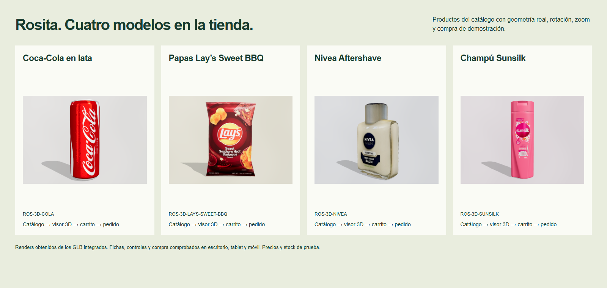

# Cuatro GLB dentro del catálogo y la compra

## Resultado

75 productos en el catálogo normal: los 63 anteriores y **12 altas aditivas**. Las altas son Coca-Cola en lata, Nivea Aftershave, Champú Sunsilk y nueve sabores Lay’s; la clásica ya existía como ROS-002. Los diez sabores se venden como productos independientes, con su propia selección, existencias y línea de pedido. No se creó un catálogo paralelo.

| Artículo | Identificador inicial | Ruta |
| --- | --- | --- |
| Coca-Cola en lata | ROS-064 | `/producto/ROS-064` |
| Papas Lay’s clásicas | ROS-002 | `/producto/ROS-002` |
| Nivea Aftershave | ROS-065 | `/producto/ROS-065` |
| Champú Sunsilk | ROS-066 | `/producto/ROS-066` |

Los nueve sabores adicionales usan ROS-067 a ROS-075, en este orden: SWEET-BBQ, CHEDDAR, CHILE-LIMON, FLAMING-HOT, HONEY-BBQ, CLASSIC-LESS-SALT, DILL-PICKLE, RANCH-WAVY y BBQ-WAVY. Son los nombres identificados en las mallas originales; no se inventaron sabores. La búsqueda acepta apóstrofo recto y tipográfico.

## Datos comerciales

**Son valores de prueba, no ofertas ni inventario real.** Están etiquetados en las tarjetas y fichas. Los valores iniciales se configuran en `src/data/model-catalog.ts` y después se editan con los controles administrativos existentes.

- Lata: S/ 4.50, 12 unidades iniciales de prueba.
- Nivea: S/ 24.90, 8 unidades iniciales de prueba.
- Sunsilk: S/ 12.90, 10 unidades iniciales de prueba.
- Cada nuevo sabor Lay’s: S/ 4.00, 12 unidades iniciales de prueba.
- ROS-002 mantiene su precio e inventario anteriores. ROS-001 conserva la botella de 600 ml y su fotografía, con `modelUrl: null`.

`integrateModelCatalog` es una migración aditiva con revisión persistida. Se ejecuta también al cargar datos de versión 9, que antes no pasaban por las ampliaciones del catálogo. No se vuelve a ejecutar el enriquecimiento antiguo ni se renumeran artículos anteriores. Un ID/código ocupado recibe un sufijo para el nuevo registro, y `modelKey` mantiene la asociación. Una coincidencia comercial exacta existente recibe solo la referencia, sin sobrescribir inventario ni reactivar registros. La migración no modifica pedidos, movimientos, carrito, borradores o sesiones. Editar el precio conserva `modelKey`, y recargar nunca restaura el valor inicial.

## Geometría, preparación y recursos

Auditoría exacta: `asset-audit.json`. Reproducción de la extracción: `python3 docs/models-integration-verification/prepare-models.py`. Se conservaron geometría, UV y mapas originales en los objetos extraídos; no se simulan modelos con fotografías.

| Fuente local | Inspección | Uso en producción |
| --- | --- | --- |
| `coca_cola_cans.glb` | 3 mallas, 66 951 triángulos, 6 texturas | Una lata completa, malla 2, aislada en `/models/coca-cola/can.glb` (~5.11 MB). No corresponde a un paquete de tres. |
| `lays_bags__10_different_flavours__gameready.glb` | 10 mallas, 680 triángulos totales, 10 materiales y 11 texturas | Diez GLB separados en `/models/lays/`, uno por sabor, ~2.18–2.65 MB por ficha; no se descargan las otras nueve bolsas al abrir una. |
| `nivea_aftershave.glb` | 3 mallas, 190 492 triángulos, 1 textura escaneada | Archivo original de ~9.37 MB, sin modificar. Conserva `KHR_materials_unlit`: no se presenta como un PBR reconstruido. Rotación inicial de π para mostrar la etiqueta frontal. |
| `sunsilk_shampoo_bottle.glb` | 7 mallas, 56 504 triángulos, 2 texturas | Una botella con cuerpo frontal, reverso y tapa (mallas 0, 1 y 2), sin el plano ni el segundo frasco. `/models/sunsilk/bottle.glb`, ~2.06 MB. |

Las miniaturas PNG se renderizaron en el visor desde los GLB, no son fotografías ni imágenes generadas. Las doce miniaturas suman aproximadamente 1.8 MB y tienen etiquetas «Render 3D». ROS-002 conserva su foto original. Estas miniaturas sirven también de alternativa si no hay WebGL o falla el modelo.

El visor es único y reutilizable. `product-models.ts` contiene rutas, altura normalizada, orientación, posición opcional, cámara, iluminación, materiales, fondo, controles y créditos. La lata usa un relleno frontal amplio y ajustes de rugosidad/metal para evitar reflejos negros que ocultaban la marca. Sunsilk muestra su etiqueta frontal. Nivea conserva los materiales y mapas escaneados originales.

El motor Three.js se importa de forma diferida solo al acercarse a un visor con GLB. Cada ficha descarga únicamente su objeto. Se limita la resolución de texturas antes de subirlas a GPU (1024 móvil/2048 escritorio), DPR ≤1.5 y render activo ≤30 fps; se pausa fuera de pantalla o con la pestaña oculta y se liberan geometría, texturas y materiales al desmontar. El peso en disco de los diez GLB Lay’s supera al archivo conjunto porque cada descarga independiente incluye su mapa compartido; el ahorro se aplica a la descarga por ficha, no al total del repositorio.

## Procedencia y licencias

Metadatos embebidos en los cuatro archivos suministrados, conservados en la auditoría y mostrados como créditos en las fichas:

- Safat_Rules: [Coca cola cans](https://sketchfab.com/3d-models/coca-cola-cans-fe5ba57722a74dba8d19f513e4672e1c), [CC BY 4.0](https://creativecommons.org/licenses/by/4.0/). Adaptación: una lata aislada; ajuste de iluminación y materiales del visor.
- NKaap: [Lay’s, diez sabores](https://sketchfab.com/3d-models/lays-bags-10-different-flavours-gameready-3b3a1f7654a5447eb25c9845152cfc89), [CC BY 4.0](https://creativecommons.org/licenses/by/4.0/). Adaptación: objetos separados conservando sus mapas y UV.
- Qlone: [Nivea Aftershave](https://sketchfab.com/3d-models/nivea-aftershave-7b3a3b4287264351ab9dcbe5cbb203e2), [CC BY-ND 4.0](https://creativecommons.org/licenses/by-nd/4.0/). Se distribuye el archivo original intacto; no se simplificó su geometría ni se convirtieron sus materiales.
- Samer_Arab_S5: [Sunsilk shampoo bottle](https://sketchfab.com/3d-models/sunsilk-shampoo-bottle-405fbff6a52f4958b19702200561901b), [CC BY 4.0](https://creativecommons.org/licenses/by/4.0/). Adaptación: una botella completa, sin el plano ni el duplicado.

## Comprobación

- `npm run check`: TypeScript, ESLint, contraste y compilación.
- `node scripts/verify-model-catalog.mjs`: esquema, ampliación, carga de versión 9, idempotencia, colisiones, conservación de datos y edición de precio con referencia 3D.
- `npm run test:operations`: permisos, caja, pedidos, existencias compartidas, migraciones históricas con pedidos y movimientos existentes, reportes y persistencia.
- `verify.mjs`: Chrome/Playwright en 1440, 768 y 390 px. Busca cada producto, entra desde su tarjeta, comprueba precio/stock, compara píxeles tras rotar y ampliar, prueba arrastre táctil, agrega al carrito, completa una compra de los cuatro productos y verifica el descuento único de stock. Comprueba los diez sabores, filtro Nivea, persistencia tras recarga y botella ROS-001 sin descargar el motor 3D.

Los scripts aceptan `PLAYWRIGHT_MODULE`, `PLAYWRIGHT_EXPECT_MODULE`, `CHROME_PATH`, `BASE_URL` y `VERIFICATION_OUT`. Las capturas finales y resultados se guardan en esta carpeta. Se mantiene el aviso de Vite por el chunk diferido del motor 3D (~1.05 MB sin comprimir); no se han añadido dependencias.

## Evidencia visual final

- [Coca-Cola lata, escritorio](screenshots/coca-cola-can-1440.png) · [móvil](screenshots/coca-cola-can-390.png)
- [Lay’s clásica, escritorio](screenshots/lays-classic-1440.png) · [móvil](screenshots/lays-classic-390.png)
- [Nivea, escritorio](screenshots/nivea-aftershave-1440.png) · [móvil](screenshots/nivea-aftershave-390.png)
- [Sunsilk, escritorio](screenshots/sunsilk-shampoo-1440.png) · [móvil](screenshots/sunsilk-shampoo-390.png)
- [Diez sabores en catálogo](screenshots/lays-catalog-1440.png) · [carrito de cuatro productos](screenshots/cart-1440.png)

`browser-results.json`: 1440/768/390 px aprobados, sin errores de JavaScript ni recursos fallidos. Cada compra de prueba incluyó dos latas y una unidad de cada uno de los otros tres artículos: cinco unidades, cuatro líneas y S/50.80. Después de confirmar, lata 10, clásica 17, Nivea 7 y Sunsilk 9 unidades; la botella ROS-001 se mantuvo en 24. Recargar conservó el pedido, los 75 registros y ese inventario sin volver a aplicar valores iniciales.

Para probar el arrastre táctil se cerró primero la navegación temporal que aparece al hacer scroll ascendente. El test comprueba que el toque llega al lienzo antes de comparar píxeles; no confunde el desplazamiento del header con una rotación del modelo.

Actualización: los códigos públicos ahora son ROS-064 a ROS-075; los cuatro artículos se muestran entre los destacados ordinarios de `/catalogo` sin parámetros, mezclados con los anteriores. En sesiones antiguas se conservan las claves internas como referencias históricas, y los enlaces públicos usan el código comercial normal. Ver `docs/normal-catalog-verification/README.md`.
