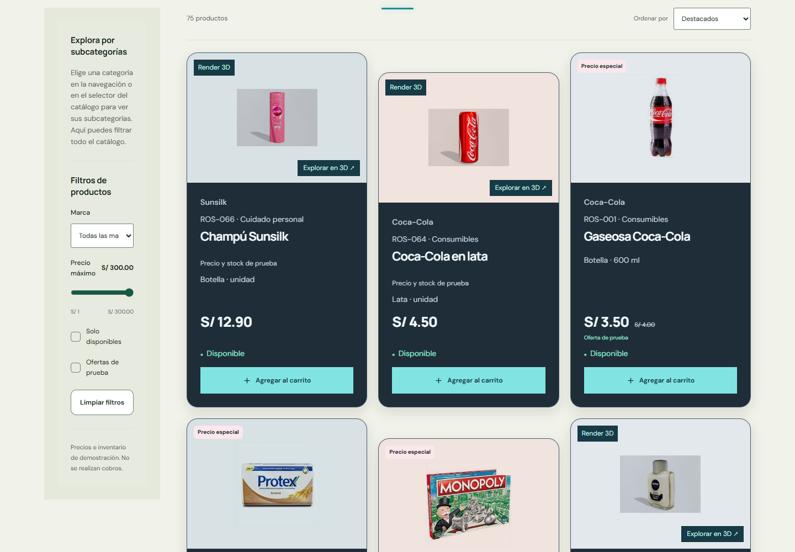

# Refinamiento UX: cristal solo en tarjetas

La corrección más reciente prevalece sobre la propuesta de fondo oscuro del adjunto. **El fondo general, los formularios, header, footer, visor, administración y contenido de modales conservan su identidad.** Solo `ProductCard` recibe el estilo de cristal oscuro. Se retiró además el desenfoque previo de los overlays de Sheet/Dialog para que el efecto quede exclusivamente en productos.

## Tarjetas

`src/styles/product-glass.css` limita todos los selectores de cristal a `.store-shell .product-card`: fondo azul oscuro con alpha 0.91, blur 12 px (6 px en tablet/móvil), borde translúcido, reflejo interior y sombra suave. Hover de ratón: elevación de 5 px, borde turquesa e imagen a escala 1.035. El blur no se anima y no se fuerza `will-change` en todas las tarjetas. En navegadores sin soporte se usa un relleno opaco. `prefers-reduced-motion` elimina animaciones y transformaciones de interacción.

Se preservan distribución, datos, imágenes, cantidades y botones. La misma tarjeta se usa en catálogo, búsqueda, categorías, destacados y relacionados. Títulos, precios, metadatos, existencias, estados desactivados y cantidades tienen colores específicos legibles sobre cristal. `contrast-results.json` calcula contraste AA sobre el caso más claro posible detrás de la superficie semitransparente.

## Header

`use-smart-header.ts` ya no contiene listeners ni lógica de dirección del scroll. Arranca cerrado. Una franja transparente de aproximadamente 3vh (44 px táctiles) contiene únicamente una línea turquesa centrada de ~4vw, con nombre accesible invisible y foco sobre la propia línea. El movimiento real del cursor en la franja abre el panel; cruzar desde ella hacia su contenido no lo cierra. Salir programa un cierre a 650 ms. Foco en sus controles, menú y carrito mantienen abierto un header ya abierto; abrir el carrito desde fuera no lo despliega.

Toque alterna abrir/cerrar; teclado permite activarlo y Escape cierra y devuelve el foco al indicador. El panel conserva transform/opacity y queda `inert` al ocultarse. No altera el flujo ni abre/cierra por scroll. Su superficie mantiene el fondo opaco anterior, sin cristal.

## Filtros

Causas corregidas: restauración al inicio en navegaciones PUSH, foco del título que desplazaba la ventana, clave por pathname que remontaba el catálogo al cambiar de categoría y transiciones completas entre categorías usadas como filtro.

`catalogNavigationOptions` captura el viewport al actualizar parámetros. React Router recibe `preventScrollReset` y estado de conservación; `useStoreScroll` los respeta. El contenedor del catálogo tiene una clave estable para catálogo/categorías y se evita la cortina/entrada de página al filtrar. Cuando la lista se acorta, se reserva solo el espacio mínimo del viewport actual para que el navegador no limite el scroll por reducirse la altura del documento; no se conserva artificialmente toda la altura de la lista anterior. Se mantienen URL, búsqueda, marca, disponibilidad, precio y orden. El selector de categoría conserva los demás parámetros y elimina solo la subcategoría anterior.

## Vídeos

Se retiró el `onPlay` que pausaba todos los demás vídeos. Los cambios de visibilidad no desmontan el nodo, no limpian `src` y no modifican `currentTime`. Fuera de pantalla se pausa conservando el fotograma y al volver se reanuda en su posición. Eventos `canplay`/`loadeddata`/`stalled`, recuperación periódica ligera y gesto de usuario permiten recuperarse de pausas/AbortError sin recargar. `NotAllowedError` respeta la política de autoplay y espera interacción. Las fuentes siguen siendo diferidas; reducción de movimiento, ahorro de datos y dispositivos limitados conservan el póster.

Las películas alternativas de un capítulo ahora tienen nodos estables, uno por archivo. Cambiar de Coca-Cola a Inka Kola y volver conserva el tiempo de cada una. El scanner de cámara de caja conserva su gestión propia de cámara y no se modifica.

## Pruebas

- `npm run check`: TypeScript, ESLint, contraste general y compilación.
- `verify.mjs`: Chrome a 1440/768/390, sin reducción de movimiento. Header cerrado al cargar y tras scroll ascendente/descendente, proximidad, toque, foco y salida. Verifica blur real y fondo general anterior; marca, disponibilidad, precio, orden, búsqueda y categoría mantienen scroll dentro de 1 px y el mismo nodo del catálogo/documento.
- `videos.mjs`: 1440/390. Reproducción real, retorno al mismo tiempo, ocho cambios rápidos de viewport, recuperación de pausa simulada, mismo nodo/src y **cero eventos `loadstart`/`emptied`** tras la carga inicial. En móvil prueba también cambiar de película y volver. No hay fuentes de vídeo duplicadas.
- `commerce.mjs`: 1440/390. Agregar desde tarjeta y visor comparte carrito/stock; abrir carrito externo no abre header, abrirlo desde header lo mantiene visible. Modales, login y administración sin blur. Destacados y relacionados sí usan las tarjetas de cristal.
- `contrast.mjs`: contraste de texto de tarjetas, botones y activador. Los precios y existencias continúan siendo los datos de demostración del catálogo; agregar no descuenta inventario.

Se mantiene el aviso de tamaño del chunk diferido del motor 3D, previo a este cambio. No se añadieron dependencias.

## Capturas finales

- [Catálogo móvil](screenshots/catalog-final-390.png)
- [Destacados móviles](screenshots/featured-glass-390.png)
- [Productos relacionados](screenshots/related-glass-1440.png)
- [Tarjeta con cantidad en carrito](screenshots/card-in-cart-1440.png)
- [Header abierto](screenshots/header-open-1440.png)
- [Login conservado](screenshots/login-unchanged-1440.png) · [Administración conservada](screenshots/admin-unchanged-1440.png)
- [Vídeo reanudado](screenshots/video-continuity-1440.png)

El inspector visual reportó 0 fallos y 6 avisos de composición/tipografía heredados. Las excepciones de cristal/sombra son el estilo solicitado explícitamente y se limitan a productos; no se extendieron a otros componentes para satisfacer el estilo. La revisión de capturas confirmó jerarquía de nombre/precio, legibilidad y separación entre tarjetas oscuras y superficies anteriores. Evaluación propia: diseño 7.5/10, usabilidad 8/10, coherencia 8/10.

La regresión de compra completa pasó a 1440/768/390: producto, registro, retiro, efectivo simulado, revisión, confirmación, seguimiento, recarga y validación de contacto. No se duplican pedidos ni se modifica stock al agregar al carrito.
