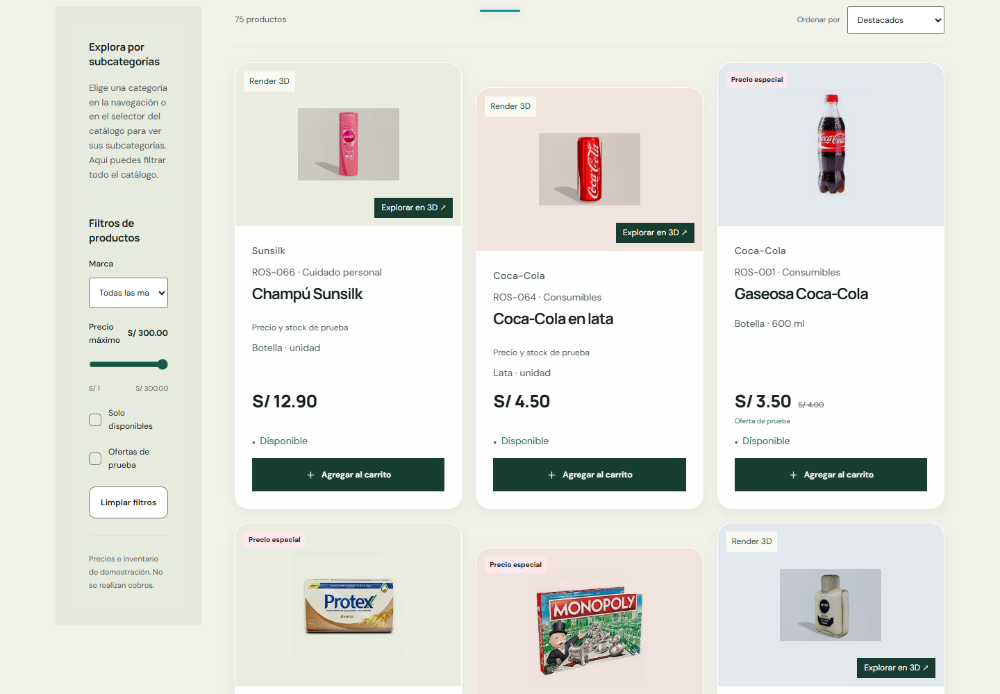

# Cristal blanco, paleta original

Único archivo de aplicación modificado: `src/styles/product-glass.css`. Se eliminaron las sobreescrituras oscuras, cyan y turquesa de las tarjetas, textos, etiquetas, botones y cantidades. Todos esos elementos vuelven a heredar sus estilos originales.

La superficie es blanca al 94%, blur de 10px (5px móvil), borde blanco translúcido, reflejo y sombras neutras. Hover blanco al 98%, sin iluminación coloreada. No se modificaron tipografía, tamaños, datos, componentes ni comportamiento; las reglas existentes de header y películas se conservaron intactas.

Compilación correcta. Chrome a 1440 y 390px comprobó: nombres/precios `#17231d`, metadatos `#526159`, stock `#216744`, botones originales `#183e30` con texto blanco, y blur activo. El fondo general conserva su color anterior.

[Móvil](mobile.png)
